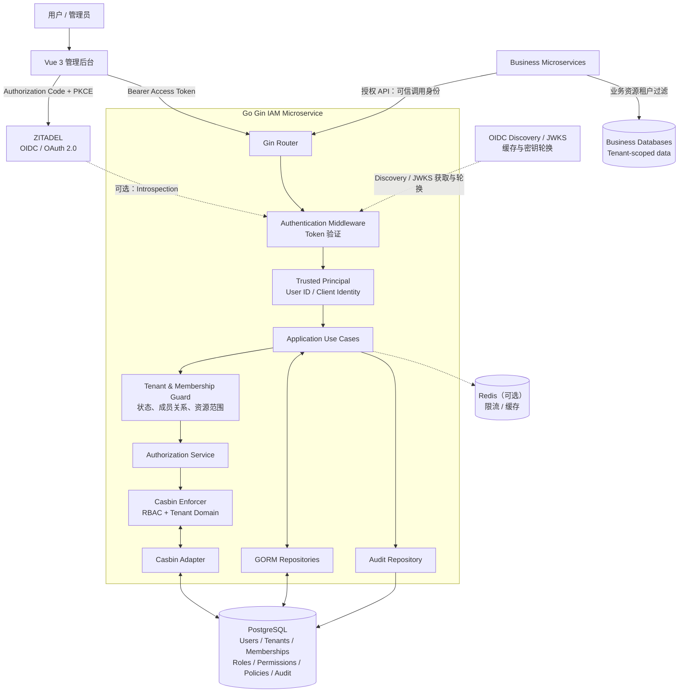

# TDD：基于 ZITADEL 的用户管理与权限授权微服务

| 文档属性 | 内容                                        |
| -------- | ------------------------------------------- |
| 文档类型 | Technical Design Document                   |
| 版本     | v1.0-draft                                  |
| 技术栈   | Go、Gin、Casbin、PostgreSQL、Redis、ZITADEL |
| 系统定位 | 独立 IAM / Authorization 微服务             |
| 前端     | Vue 3 管理后台                              |
| 部署形态 | Docker 容器化、REST API                     |
| 认证方式 | OIDC / OAuth 2.0                            |
| 授权模型 | RBAC + Tenant Domain                        |
| 数据访问 | GORM                                        |
| API 规范 | REST + OpenAPI 3.0                          |

## 1. 项目背景与目标

### 1.1 项目背景

系统以 ZITADEL 作为身份认证基础设施，在其上构建一套可供 SaaS 产品使用的用户管理、租户管理、角色管理、权限配置和授权服务。

ZITADEL 提供身份认证、用户身份管理、应用注册及相关 API；本服务不重复实现密码认证、登录流程、MFA 和 OIDC Provider，而是负责 SaaS 业务层的用户关系和授权。

### 1.2 建设目标

1. **身份统一**：以 ZITADEL 用户 ID 作为外部身份的唯一关联标识。
2. **用户管理**：维护业务用户资料、用户状态和业务侧扩展信息。
3. **租户隔离**：支持用户加入多个租户，并在不同租户拥有不同角色。
4. **RBAC 授权**：支持角色、权限、角色分配及资源操作控制。
5. **管理后台**：为 Vue 管理后台提供统一的用户、角色、权限和租户管理 API。
6. **服务复用**：通过标准 HTTP API 为多个 SaaS 业务服务提供授权能力。
7. **安全审计**：记录高风险管理操作、角色变更及授权变更。
8. **可测试性**：通过 TDD 建立业务规则、授权边界和多租户隔离的自动化测试。

### 1.3 非建设目标

首期不实现以下功能：

- 自建登录、注册密码校验和密码找回系统。
- 自建 OAuth 2.0 / OIDC Identity Provider。
- 替代 ZITADEL Console 管理 ZITADEL 实例。
- 复杂的 ABAC、ReBAC、组织树继承和策略脚本引擎。
- 完整的工作流、审批流和企业 HR 组织管理。
- 把每个 SaaS 业务服务的领域数据全部迁移到 IAM 数据库。

### 1.4 核心设计原则

- ZITADEL 是身份事实来源；本服务是业务授权事实来源。
- 业务租户、成员关系、角色和权限由本服务管理。
- 所有业务授权必须显式携带可信的租户上下文。
- 未定义的权限默认拒绝。
- 不信任前端传入的用户 ID、租户 ID 或角色名称。
- 授权核心与 Gin、GORM、Redis、Casbin 具体实现保持适当解耦。
- MVP 采用模块化单体部署，保留演进为多实例微服务的能力。

## 2. 系统架构

### 2.1 总体架构



> 图中业务微服务可以调用 IAM 的授权 API，也可以通过共享的、版本化的授权 SDK 执行授权。MVP 优先采用远程授权 API，避免每个业务服务自行维护一套策略副本。

### 2.2 系统职责边界

| 能力             | ZITADEL            | IAM 微服务           |
| ---------------- | ------------------ | -------------------- |
| 用户身份唯一标识 | 负责               | 保存外部 ID 映射     |
| 登录、MFA、SSO   | 负责               | 不实现               |
| OIDC / OAuth 2.0 | 负责               | 作为 Resource Server |
| 身份资料         | 权威身份资料       | 业务扩展资料         |
| 业务租户         | 可有 Organization  | 业务 Tenant          |
| 业务租户成员关系 | 非本服务的业务事实 | 负责                 |
| 业务角色与权限   | 可提供应用级角色   | 细粒度权限的权威来源 |
| 资源级授权       | 不作为主要职责     | Casbin 负责决策      |
| 业务审计         | 身份平台审计       | 业务权限审计         |

ZITADEL 的 Project 可以组织应用、角色和角色分配；但本项目的租户级业务权限由 IAM 自己管理。参考：[ZITADEL Projects](https://zitadel.com/docs/guides/manage/console/projects-overview)。

### 2.3 多租户建模

首期使用以下映射：

```text
ZITADEL Instance
    └── Application Organization
          └── SaaS Project
                ├── Vue Application
                └── IAM API

IAM PostgreSQL
    ├── User
    ├── Tenant
    ├── Membership
    ├── Role
    ├── Permission
    └── Casbin Policies
```

业务租户与 ZITADEL Organization 不强制一一对应。

同一个 ZITADEL 用户可以拥有多个 IAM Membership；每个 Membership 可以具有不同的业务角色。

例如：

```text
ZITADEL User: 12345

Tenant A
  └── Membership: owner

Tenant B
  └── Membership: viewer
```

在 Tenant A 中，用户可以管理成员和修改配置；在 Tenant B 中，同一个用户只能查看资源。

如果未来业务转向 B2B、需要客户自行管理企业用户及企业域名登录，可以再评估把业务租户映射到 ZITADEL Organization 的方案，不在 MVP 中强制采用。

## 3. 核心业务模型

### 3.1 User

代表本系统中的业务用户，不负责认证凭据。

主要字段：

- `id`：内部 UUID。
- `zitadel_user_id`：ZITADEL 用户 ID，唯一。
- `display_name`：业务显示名称。
- `avatar_url`：头像地址。
- `status`：`active`、`disabled`。
- `created_at`、`updated_at`。

用户邮箱、手机号、邮箱验证状态等身份属性原则上以 ZITADEL 为权威来源。本地可保存经过必要同步的业务展示副本，但不得让两个系统独立修改同一个权威属性。

### 3.2 Tenant

代表 SaaS 业务租户。

字段：

- `id`：UUID。
- `name`：租户名称。
- `slug`：可读标识，唯一。
- `status`：`active`、`suspended`、`deleted`。
- `created_by`：创建者用户 ID。
- `created_at`、`updated_at`。

所有业务数据必须有明确的租户归属；系统级资源另行定义，不得通过空租户 ID 绕过隔离。

### 3.3 Membership

表示 User 与 Tenant 的关联，是租户权限的核心边界。

字段：

- `id`：UUID。
- `tenant_id`：租户 ID。
- `user_id`：内部用户 ID。
- `status`：`active`、`pending`、`suspended`、`removed`。
- `joined_at`、`created_at`、`updated_at`。

唯一约束：

```sql
UNIQUE (tenant_id, user_id)
```

只有 `active` Membership 才可以访问该租户的业务资源。

### 3.4 Role

表示租户内的一组权限。

字段：

- `id`：UUID。
- `tenant_id`：租户 ID。
- `key`：机器可读的角色标识。
- `name`：展示名称。
- `description`：描述。
- `is_system`：是否系统预置角色。
- `created_at`、`updated_at`。

唯一约束：

```sql
UNIQUE (tenant_id, key)
```

首期预置角色：

| 角色     | 说明                             |
| -------- | -------------------------------- |
| `owner`  | 租户所有者，可管理租户及成员     |
| `admin`  | 租户管理员，可管理大部分租户资源 |
| `member` | 普通成员，可执行日常操作         |
| `viewer` | 只读用户                         |

这些是业务角色，不是 ZITADEL 管理员角色。

### 3.5 Permission

表示最小粒度的操作权限。

推荐采用：

```text
resource:action
```

示例：

```text
tenant:read
tenant:update
tenant:delete

member:read
member:invite
member:update
member:remove

role:read
role:create
role:update
role:delete
role:assign

permission:read
permission:assign

audit:read
```

权限由系统维护，不允许租户管理员任意创建新的可执行权限代码。租户管理员可以在已有权限集合内组合自定义角色。

### 3.6 MembershipRole

一个成员可以拥有多个角色。

字段：

- `membership_id`。
- `role_id`。
- `assigned_by`。
- `created_at`。

唯一约束：

```sql
UNIQUE (membership_id, role_id)
```

为避免角色分配绕过租户隔离，必须保证 Membership 与 Role 属于同一个 Tenant。

### 3.7 AuditLog

记录管理操作和安全相关事件。

核心字段：

```text
id
tenant_id
actor_user_id
action
resource_type
resource_id
result
request_id
ip_address
user_agent
metadata
created_at
```

`metadata` 不得包含 Access Token、Refresh Token、密码或其他敏感认证材料。

## 4. 技术选型

| 层级       | 技术                                      | 选择理由                   |
| ---------- | ----------------------------------------- | -------------------------- |
| HTTP       | Gin                                       | 轻量，适合 Go REST API     |
| 身份协议   | OIDC / OAuth 2.0                          | 使用 ZITADEL 标准协议      |
| Token 验证 | JWT/JWKS 或 OIDC 验证库                   | 适配 JWT Access Token      |
| 授权引擎   | Casbin                                    | RBAC、Domain、策略匹配     |
| 数据库     | PostgreSQL                                | 关系数据、事务、约束、审计 |
| ORM        | GORM                                      | 数据持久化                 |
| 缓存       | Redis                                     | 可选缓存与限流             |
| 配置       | 环境变量 + 配置校验                       | 便于容器部署               |
| 日志       | `log/slog` 或 `zap`                       | 结构化日志                 |
| API 文档   | OpenAPI 3.0                               | 便于前后端协作             |
| 迁移       | Atlas、golang-migrate 等                  | 版本化数据库迁移           |
| 测试       | `testing`、`testify`、`testcontainers-go` | 单元与集成测试             |

具体库应在项目初始化时锁定版本，并由 `go.mod` 管理。不要因为选用了 GORM 就放弃数据库级外键、唯一约束和事务。

## 5. Go 项目结构

建议采用模块化分层结构：

```text
iam-service/
├── cmd/
│   └── api/
│       └── main.go
├── internal/
│   ├── config/
│   ├── domain/
│   │   ├── user/
│   │   ├── tenant/
│   │   ├── membership/
│   │   ├── role/
│   │   ├── permission/
│   │   └── audit/
│   ├── application/
│   │   ├── user/
│   │   ├── tenant/
│   │   ├── membership/
│   │   ├── role/
│   │   ├── authorization/
│   │   └── audit/
│   ├── ports/
│   │   ├── repositories.go
│   │   ├── authorizer.go
│   │   ├── identity_provider.go
│   │   └── audit.go
│   ├── adapters/
│   │   ├── postgres/
│   │   ├── casbin/
│   │   ├── redis/
│   │   └── zitadel/
│   ├── transport/
│   │   └── http/
│   │       ├── middleware/
│   │       ├── handlers/
│   │       ├── requests/
│   │       └── responses/
│   └── bootstrap/
├── migrations/
├── casbin/
│   └── model.conf
├── api/
│   └── openapi.yaml
├── tests/
│   ├── integration/
│   └── e2e/
├── deployments/
│   └── docker/
├── docs/
│   └── TDD.md
├── go.mod
├── go.sum
├── Dockerfile
└── README.md
```

### 5.1 分层规则

**Domain**

定义实体、值对象、业务不变量。不得依赖 Gin、GORM、Redis 或 Casbin。

**Application**

编排业务用例，例如邀请成员、分配角色、检查权限。通过接口访问数据库、身份平台和授权引擎。

**Ports**

定义依赖倒置所需的接口，例如 `UserRepository`、`MembershipRepository`、`Authorizer`、`IdentityProvider`。

**Adapters**

实现 PostgreSQL/GORM、Casbin、Redis、ZITADEL API 等外部依赖。

**Transport**

负责 Gin 路由、参数绑定、HTTP 状态码、认证中间件和请求上下文。

**Bootstrap**

完成配置、数据库连接、Casbin 初始化、依赖注入和 HTTP Server 启动。

## 6. 身份认证设计

### 6.1 登录流程

采用 Authorization Code + PKCE：

1. Vue 前端将用户重定向至 ZITADEL。
2. 用户在 ZITADEL 完成登录。
3. 前端获得授权结果，并按照客户端类型和 OAuth 安全要求完成 Token 交换。
4. 前端使用 Access Token 调用 IAM API。
5. Gin 中间件验证 Token，提取 `sub` 并构造可信的 Principal。
6. 应用层根据 `sub` 查找本地 User。
7. 请求涉及租户资源时，验证 Membership 与租户状态。
8. 授权层执行 Casbin 决策。

### 6.2 Token 验证要求

如果使用 JWT Access Token，至少验证：

- 签名有效，且签名算法在允许列表内。
- `iss` 与配置的 ZITADEL Issuer 完全匹配。
- `exp`、`nbf` 等时间约束。
- `aud` 包含本 API 预期的 Audience。
- `sub` 非空。
- 必要时校验 Token 类型与相关协议约束。

通过 OIDC Discovery 获取配置，通过 JWKS 验证签名，并正确处理公钥轮换。

如果配置使用不透明 Access Token，或者当前 Token 类型不适合本地验签，应使用 ZITADEL 提供的 Token Introspection 等适当验证方式。不能假设所有 Access Token 都是 JWT。

参考：[ZITADEL Token Introspection](https://zitadel.com/docs/guides/integrate/token-introspection)。

### 6.3 Principal

认证中间件向应用层提供统一身份对象：

```go
type Principal struct {
    Subject      string
    UserID       string
    ClientID     string
    Authenticated bool
}
```

其中：

- `Subject`：Token 中的 ZITADEL 用户标识。
- `UserID`：由可信的本地映射查询得到的内部用户 UUID。
- `ClientID`：仅在可靠提取并验证相关 Claim 后使用。
- `Authenticated`：由中间件设置，不允许请求参数覆盖。

`TenantID` 不应直接从任意请求 Header 中被信任。请求可以指定希望访问的租户，但服务必须检查该用户是否为有效成员。

### 6.4 本地用户同步

采用按需创建与更新的轻量同步模式：

- 第一次访问时，根据已验证 Token 的 `sub` 查找用户。
- 如果不存在，则调用适当的 ZITADEL 用户信息接口或受信任的资料同步流程。
- 创建本地业务用户映射。
- 如果身份平台暂时不可用，不应自动信任客户端提供的邮箱、手机号或昵称。
- 用户禁用、删除、身份失效等事件应有明确的同步和撤权策略。

禁止把未经验证的 JWT Claim 当作可信用户信息，也禁止使用邮箱作为外部身份的主关联键。

## 7. 授权模型设计

### 7.1 授权决策输入

统一使用以下四元组：

```text
(subject, tenant, resource, action)
```

例如：

```text
subject  = user-uuid
tenant   = tenant-uuid
resource = member
action   = invite
```

Casbin 负责角色与策略匹配，但业务层还必须验证：

- 用户存在且状态有效。
- Tenant 存在且状态有效。
- Membership 存在且为 active。
- Role 归属于当前 Tenant。
- 目标资源确实属于当前 Tenant。

**Casbin Allow 不能代替数据库租户隔离检查。**

### 7.2 Casbin 模型

文件：`casbin/model.conf`

```ini
[request_definition]
r = sub, dom, obj, act

[policy_definition]
p = sub, dom, obj, act

[role_definition]
g = _, _, _

[policy_effect]
e = some(where (p.eft == allow)) && !some(where (p.eft == deny))

[matchers]
m = r.dom == p.dom && \
    r.obj == p.obj && \
    r.act == p.act && \
    (r.sub == p.sub || g(r.sub, p.sub, r.dom))
```

这里 `dom` 表示 Tenant ID。

角色继承关系和成员角色分配均以 Tenant 为作用域。所有策略变更必须经过应用层校验，不能直接暴露任意 Casbin Policy 写入接口给前端。

### 7.3 策略示例

```csv
p, owner, tenant-001, tenant, read
p, owner, tenant-001, tenant, update
p, owner, tenant-001, member, invite
p, owner, tenant-001, member, remove
p, owner, tenant-001, role, assign

p, viewer, tenant-001, tenant, read
p, viewer, tenant-001, member, read

g, user-001, owner, tenant-001
g, user-002, viewer, tenant-001
```

示例仅用于解释策略结构，实际数据必须使用数据库中的 UUID，并通过事务和策略管理服务生成。

### 7.4 角色和权限映射

建议将角色、权限与 Casbin 策略分别管理：

- `Role`：业务角色定义。
- `Permission`：系统支持的操作。
- `RolePermission`：角色和权限的多对多关系。
- `MembershipRole`：成员与角色的关系。
- Casbin Adapter：根据这些关系构建和执行授权策略。

这样既能支持管理后台展示角色包含的权限，也能避免将 Casbin 内部策略格式直接暴露给业务用户。

### 7.5 权限决策接口

应用层接口：

```go
type Authorizer interface {
    Enforce(
        ctx context.Context,
        subject string,
        tenantID string,
        resource string,
        action string,
    ) (bool, error)
}
```

应用层在调用之前，必须完成用户状态、租户状态及 Membership 校验。

建议区分：

- `allowed = false, err = nil`：明确拒绝。
- `err != nil`：授权依赖不可用或决策无法完成。

授权系统异常时必须失败关闭（fail closed），不能因 Redis、数据库或 Casbin 故障自动放行。

### 7.6 系统管理员与租户管理员

采用两类独立权限：

**平台管理员**

- 管理租户状态。
- 查看平台范围的必要运营信息。
- 执行受审计保护的系统管理操作。

**租户管理员**

- 只能管理自己所属租户。
- 不能通过修改请求中的 `tenant_id` 访问其他租户。
- 不能修改平台级策略或管理平台管理员。

平台权限必须使用独立的、显式的授权路径，不要把特殊字符串 `*` 或空 Tenant ID 作为隐式超级管理员。

## 8. 数据库设计

### 8.1 表清单

| 表名               | 用途               |
| ------------------ | ------------------ |
| `users`            | 业务用户映射       |
| `tenants`          | 业务租户           |
| `memberships`      | 用户与租户关系     |
| `roles`            | 角色定义           |
| `permissions`      | 系统权限目录       |
| `role_permissions` | 角色权限关联       |
| `membership_roles` | 成员角色分配       |
| `casbin_rule`      | Casbin 策略持久化  |
| `audit_logs`       | 审计记录           |
| `idempotency_keys` | 可选的幂等请求记录 |

### 8.2 数据库约束

至少实施以下约束：

- `users.zitadel_user_id` 唯一。
- `memberships(tenant_id, user_id)` 唯一。
- `roles(tenant_id, key)` 唯一。
- `role_permissions(role_id, permission_id)` 唯一。
- `membership_roles(membership_id, role_id)` 唯一。
- 相关外键、非空约束及合理的索引。
- 业务表的 Tenant ID 必须显式存在。
- 删除成员、角色或租户时采用明确的事务和软删除策略。

特别是 `membership_roles`，应通过复合外键、额外关联表或事务内验证，保证被分配角色的 Tenant 与 Membership 的 Tenant 一致。仅仅检查两个 UUID 存在是不够的。

### 8.3 事务与授权一致性

角色权限变更涉及多个数据对象时，必须在同一个数据库事务中更新：

1. 业务关系表。
2. Casbin 持久化策略。
3. 审计记录。

如果使用 Casbin GORM Adapter，应验证它与业务事务是否确实共享同一个事务连接；不能因为两个组件都使用 GORM 就默认具备原子性。

对于无法直接纳入同一事务的外部副作用，可采用 Outbox 模式。

### 8.4 Redis 使用原则

Redis 仅作为可选的性能优化组件，不作为唯一的授权事实来源。

可用于：

- 频率限制。
- 短时授权决策缓存。
- 用户或租户状态缓存。
- 策略版本和缓存失效通知。

缓存键必须包含用户、Tenant、资源和操作等必要维度。角色或 Membership 变更后，应失效相关缓存。对成员移除、租户停用等高风险操作，不能仅依赖长期缓存。

## 9. REST API 设计

统一前缀：

```text
/api/v1
```

### 9.1 当前用户

| 方法 | 路径              | 说明                 |
| ---- | ----------------- | -------------------- |
| GET  | `/me`             | 当前用户资料         |
| GET  | `/me/tenants`     | 当前用户所属租户     |
| GET  | `/me/permissions` | 当前租户可用权限摘要 |

### 9.2 租户管理

| 方法  | 路径                         | 说明           |
| ----- | ---------------------------- | -------------- |
| POST  | `/tenants`                   | 创建租户       |
| GET   | `/tenants`                   | 查询可访问租户 |
| GET   | `/tenants/:tenantID`         | 查询租户详情   |
| PATCH | `/tenants/:tenantID`         | 修改租户信息   |
| GET   | `/tenants/:tenantID/members` | 查询成员       |

### 9.3 成员管理

| 方法   | 路径                                       | 说明           |
| ------ | ------------------------------------------ | -------------- |
| POST   | `/tenants/:tenantID/invitations`           | 邀请或添加成员 |
| GET    | `/tenants/:tenantID/members/:userID`       | 查看成员       |
| PATCH  | `/tenants/:tenantID/members/:userID`       | 修改成员状态   |
| DELETE | `/tenants/:tenantID/members/:userID`       | 移除成员       |
| GET    | `/tenants/:tenantID/members/:userID/roles` | 查询成员角色   |
| PUT    | `/tenants/:tenantID/members/:userID/roles` | 设置成员角色   |

成员邀请流程需要定义邀请对象的身份识别、有效期、重复邀请和接受邀请机制。不要直接创建一个仅凭邮箱字符串就能登录的本地用户。

### 9.4 角色和权限

| 方法   | 路径                                           | 说明             |
| ------ | ---------------------------------------------- | ---------------- |
| GET    | `/permissions`                                 | 查询系统权限目录 |
| GET    | `/tenants/:tenantID/roles`                     | 查询租户角色     |
| POST   | `/tenants/:tenantID/roles`                     | 创建自定义角色   |
| GET    | `/tenants/:tenantID/roles/:roleID`             | 查询角色         |
| PATCH  | `/tenants/:tenantID/roles/:roleID`             | 修改角色         |
| DELETE | `/tenants/:tenantID/roles/:roleID`             | 删除角色         |
| PUT    | `/tenants/:tenantID/roles/:roleID/permissions` | 设置角色权限     |

### 9.5 授权与审计

| 方法 | 路径                            | 说明                 |
| ---- | ------------------------------- | -------------------- |
| POST | `/authorize`                    | 检查指定资源操作权限 |
| GET  | `/tenants/:tenantID/audit-logs` | 查询租户审计日志     |
| GET  | `/health/live`                  | 存活检查             |
| GET  | `/health/ready`                 | 就绪检查             |

`/authorize` 的请求体只能表达需要判断的资源与操作，不能自行声明调用者身份。

例如：

```json
{
  "tenant_id": "tenant-uuid",
  "resource": "member",
  "action": "invite"
}
```

调用者身份必须从已验证的 Token 或经过认证的服务身份中取得。

### 9.6 统一响应格式

成功：

```json
{
  "data": {},
  "request_id": "req-uuid"
}
```

失败：

```json
{
  "error": {
    "code": "FORBIDDEN",
    "message": "Permission denied"
  },
  "request_id": "req-uuid"
}
```

推荐的 HTTP 状态码：

- `400`：参数错误。
- `401`：缺少或无效的身份凭证。
- `403`：身份有效但权限不足。
- `404`：资源不存在，或根据防枚举策略隐藏资源存在性。
- `409`：状态冲突或唯一约束冲突。
- `422`：业务规则校验失败（若团队规范采用）。
- `429`：请求频率超限。
- `500`：未预期的服务端错误。
- `503`：必要依赖暂时不可用。

## 10. 安全设计

### 10.1 多租户隔离

所有读取和修改必须同时满足：

```text
Authenticated
AND UserActive
AND TenantActive
AND MembershipActive
AND ResourceBelongsToTenant
AND PermissionGranted
```

不能只依赖 Casbin 的策略匹配。SQL 查询必须带上 Tenant 条件，例如：

```sql
SELECT *
FROM memberships
WHERE tenant_id = $1
  AND user_id = $2;
```

对更新和删除也应将 Tenant 条件纳入 SQL，而不是先根据全局 ID 查出资源后就直接修改。

### 10.2 管理员保护

- 禁止租户管理员提升为平台管理员。
- 不能移除最后一个有效的 Owner。
- Owner、Admin 等高权限角色变更必须审计。
- 删除角色时必须检查是否仍有成员使用。
- 修改角色权限时，必须限制可分配权限范围。
- 不能通过批量 API 绕过单项操作的权限检查。

### 10.3 服务间认证

其他业务微服务调用 IAM 时，应使用独立的服务身份，推荐采用适当的 OAuth 2.0 Client Credentials 流程。

需要区分：

- 用户委托调用：保留真实用户身份和授权上下文。
- 服务自身调用：明确服务主体与允许的权限。
- 代用户执行操作：显式传递可信的委托上下文，并保留审计信息。

禁止接受任意客户端提交的 `X-User-ID` 作为真实用户身份。内部网络本身不构成认证。

### 10.4 速率限制和审计

- 登录相关操作由 ZITADEL 负责相应保护。
- IAM 对管理 API 和授权 API 实施限流。
- 对角色分配、成员移除、租户停用等操作记录审计。
- 日志禁止包含完整 Token 和敏感凭据。
- 审计日志的访问权限应独立定义。

## 11. TDD 实施策略

### 11.1 测试分层

| 层级                 | 目标                          | 依赖                    |
| -------------------- | ----------------------------- | ----------------------- |
| Domain 单元测试      | 业务不变量                    | 不需要外部服务          |
| Application 单元测试 | 用例编排与错误处理            | Mock Ports              |
| Casbin 测试          | 角色、Tenant Domain、策略匹配 | 测试模型与策略          |
| Repository 集成测试  | SQL、约束、事务               | PostgreSQL              |
| HTTP 集成测试        | 路由、认证、授权、响应码      | Gin + 测试依赖          |
| E2E 测试             | 登录后端到端流程              | 测试 ZITADEL / 测试环境 |
| 安全回归测试         | 越权、跨租户访问、撤权        | 完整授权链路            |

不应追求所有代码都通过 Mock 测试；数据库约束、Casbin Adapter 事务和真实 Token 验证都需要集成测试。

### 11.2 TDD 循环

每个业务功能按照以下顺序开发：

1. 编写失败的测试，明确预期行为。
2. 实现最小代码使测试通过。
3. 重构 Domain / Application / Adapter 的边界。
4. 增加异常路径与安全测试。
5. 运行单元测试、集成测试和静态检查。
6. 更新 API 文档及迁移脚本。

### 11.3 核心验收测试

**身份认证**

- 无 Token 请求受保护 API 返回 `401`。
- 签名无效、Issuer 错误、Audience 错误或 Token 过期均被拒绝。
- 未知 ZITADEL `sub` 不能通过客户端伪造用户资料建立可信身份。

**租户隔离**

- Tenant A 的用户不能读取 Tenant B 的成员。
- 修改请求中的 Tenant ID 不能提升权限。
- Tenant A 的角色不能分配给 Tenant B 的 Membership。
- 租户停用后，其成员不能继续执行租户级业务操作。
- 被移除的成员不能通过旧缓存继续访问受保护资源。

**角色权限**

- Viewer 不能邀请成员。
- Admin 不能修改平台级权限。
- 未分配权限时默认拒绝。
- 修改角色权限后，旧的授权决策不会在规定的撤权窗口之外继续生效。
- 不允许移除最后一个有效 Owner。

**事务与故障**

- 角色分配失败时，不留下部分业务数据。
- Casbin 策略持久化失败时，事务正确回滚。
- PostgreSQL 或授权依赖不可用时，受保护操作不会自动放行。
- 重复提交成员邀请或角色分配请求不会产生不一致数据。

## 12. 性能与可靠性

### 12.1 初始目标

以下数值是首期工程目标，需在目标部署环境通过压测验证，并非当前实测结果。

- 纯本地授权决策：P95 不超过 10 ms。
- 常规业务 API：P95 不超过 200 ms，不包含用户交互式登录。
- 单实例支持至少 100 个并发请求，作为初始压测基线。
- 正常运行时，授权路径不应每次都请求 ZITADEL。
- PostgreSQL、Redis 和 ZITADEL 的调用均需设置合理超时。

### 12.2 可用性设计

- Gin API 无状态化，支持水平扩容。
- PostgreSQL 为业务数据与策略持久化的权威存储。
- Redis 故障不能导致授权默认放行。
- Casbin 策略缓存应在多实例间具备可靠的失效机制。
- 启动时校验配置、数据库迁移状态和必要依赖。
- 就绪检查应反映服务是否具备处理请求的条件。

### 12.3 策略一致性

多实例部署时，不能仅在当前进程中修改 Casbin Enforcer。

需要选择并验证：

- 使用 Casbin 官方或兼容的共享策略存储方案。
- 通过 Watcher 或等效机制传播策略更新。
- 采用策略版本号，检测并刷新过期的本地缓存。
- 高风险授权操作采用明确的失效与生效语义。

首期可以使用 PostgreSQL 持久化策略，后续再根据实际负载引入 Redis 缓存。

## 13. 部署与配置

### 13.1 部署组件

```text
Docker Network
├── traefik
├── iam-service
├── postgres
├── redis          (optional)
└── zitadel        (existing / external)
```

如果 ZITADEL 已独立部署，IAM 不应将它作为强制同容器组件。网络访问、Issuer、TLS 证书和服务身份应独立配置。

### 13.2 环境变量

```dotenv
APP_ENV=production
APP_HTTP_ADDR=:8080

DATABASE_DSN=
REDIS_ADDR=

ZITADEL_ISSUER=https://auth.example.com
ZITADEL_CLIENT_ID=
ZITADEL_API_AUDIENCE=
ZITADEL_SERVICE_CREDENTIALS_FILE=

AUTH_TOKEN_MODE=jwt
AUTH_JWKS_CACHE_TTL=15m

CASBIN_MODEL_PATH=./casbin/model.conf

LOG_LEVEL=info
```

说明：

- `ZITADEL_API_AUDIENCE` 必须与实际 Token 中的 `aud` 匹配，不能猜测。
- `ZITADEL_SERVICE_CREDENTIALS_FILE` 仅用于需要访问 ZITADEL 管理 API 的服务身份；应使用 Secret 管理，避免将私钥写入镜像。
- `AUTH_TOKEN_MODE=jwt` 仅在选定的 Token 类型适用本地 JWT 验签时启用。
- 所有生产配置应在启动时校验，缺少必要配置时快速失败。

### 13.3 CI/CD

建议流水线：

1. `gofmt` 与 `go vet`。
2. 单元测试。
3. Casbin 策略测试。
4. PostgreSQL 集成测试。
5. 依赖漏洞扫描与静态分析。
6. Docker 镜像构建。
7. 测试环境部署与 E2E 测试。
8. 数据库迁移检查。
9. 生产部署与健康检查。

数据库迁移应使用独立、可审计的步骤执行，避免多个 API 实例启动时同时执行不可控的结构变更。

## 14. 分阶段交付计划

### Phase 1：基础工程

- 创建 Go 项目结构。
- 配置 Gin、GORM、PostgreSQL 和 Casbin。
- 建立数据库迁移机制。
- 完成 `/health/live` 和 `/health/ready`。
- 配置 CI 与单元测试。

验收：项目可以在本地和 Docker 环境启动，测试可重复执行。

### Phase 2：ZITADEL 身份接入

- 配置 OIDC Issuer、Audience 与 Token 验证。
- 实现认证中间件和 Principal。
- 实现 User 按需同步。
- 处理无效身份与依赖不可用的情况。

验收：有效 Token 可以访问受保护 API，伪造或过期 Token 被拒绝。

### Phase 3：租户与成员管理

- 实现 Tenant、Membership。
- 实现用户租户列表。
- 实现成员邀请、移除、停用。
- 建立租户隔离查询规则。
- 增加跨租户安全测试。

验收：所有租户级 API 均执行成员资格和租户状态检查。

### Phase 4：RBAC

- 实现 Role、Permission、RolePermission。
- 实现 Casbin Domain 模型。
- 实现成员角色分配。
- 实现 `/authorize`。
- 实现策略事务和多实例失效机制。

验收：授权结果与业务关系一致，策略变更可以正确撤权。

### Phase 5：管理后台 API

- 实现角色和权限目录。
- 实现管理接口及分页过滤。
- 完善错误码、OpenAPI 文档。
- 增加审计日志。
- 接入 Vue 管理后台。

验收：管理员能够完成租户成员管理和角色权限配置。

### Phase 6：生产加固

- 性能与并发压测。
- 限流、审计与监控。
- 备份与恢复演练。
- 安全测试。
- Docker 与 CI/CD 发布流程。

验收：核心安全测试全部通过，性能目标经过实际压测验证。

## 15. 风险与待决策事项

| 风险或决策                                  | 建议                                     |
| ------------------------------------------- | ---------------------------------------- |
| ZITADEL Organization 与业务 Tenant 概念混淆 | 首期明确分离                             |
| JWT 与不透明 Token 验证方式不匹配           | 在实际客户端配置后确定                   |
| Casbin 策略与业务表事务不一致               | 编写真实 PostgreSQL 集成测试             |
| 多实例策略更新延迟                          | 设计 Watcher、版本号与缓存失效           |
| 平台管理员越权                              | 独立平台授权路径并记录审计               |
| 用户状态同步延迟                            | 明确禁用、删除和撤权时效                 |
| 业务服务绕过 IAM                            | 统一授权 SDK / API，并保留业务端强制校验 |
| 权限目录被租户随意扩展                      | 由系统维护可执行 Permission 集合         |

## 16. 最终验收标准

项目进入正式生产前，应至少满足以下条件：

- [ ] ZITADEL Token 验证通过真实 Token 集成测试。
- [ ] User、Tenant、Membership、Role、Permission 数据模型完成。
- [ ] 所有租户级 API 均具备明确的 Tenant 隔离。
- [ ] Casbin 使用 Domain 模型执行 RBAC。
- [ ] 角色权限修改具备事务一致性与缓存失效策略。
- [ ] 平台管理员与租户管理员权限分离。
- [ ] 核心操作具备审计记录。
- [ ] 跨租户越权测试全部通过。
- [ ] 数据库迁移、备份与恢复流程经过验证。
- [ ] OpenAPI 文档、部署配置与 CI/CD 流程完成。

## 17. 官方参考资料

1. [ZITADEL API Reference Overview](https://zitadel.com/docs/apis/introduction)
2. [ZITADEL Projects Overview](https://zitadel.com/docs/guides/manage/console/projects-overview)
3. [ZITADEL Organizations Overview](https://zitadel.com/docs/guides/manage/console/organizations-overview)
4. [ZITADEL Retrieve User Roles](https://zitadel.com/docs/guides/integrate/retrieve-user-roles)
5. [ZITADEL Access APIs](https://zitadel.com/docs/guides/integrate/zitadel-apis/access-zitadel-apis)
6. [ZITADEL Token Introspection](https://zitadel.com/docs/guides/integrate/token-introspection)
7. [Casbin Documentation](https://casbin.org/docs/overview)
8. [Gin Documentation](https://gin-gonic.com/docs/)
9. [GORM Documentation](https://gorm.io/docs/)

---

**文档状态：Draft。**

在正式编码前，需要确认 Token 验证模式、平台管理员边界、租户创建权限、成员邀请机制，以及 Casbin 策略更新的一致性要求。这些决策会直接影响数据库约束、API 设计与测试用例。
